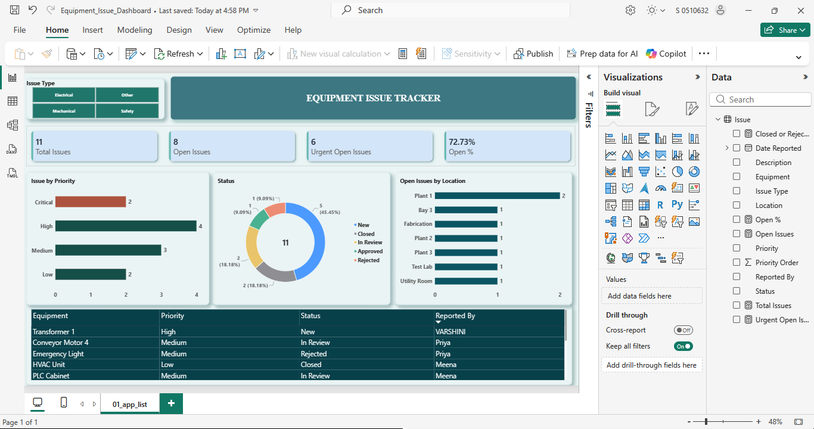
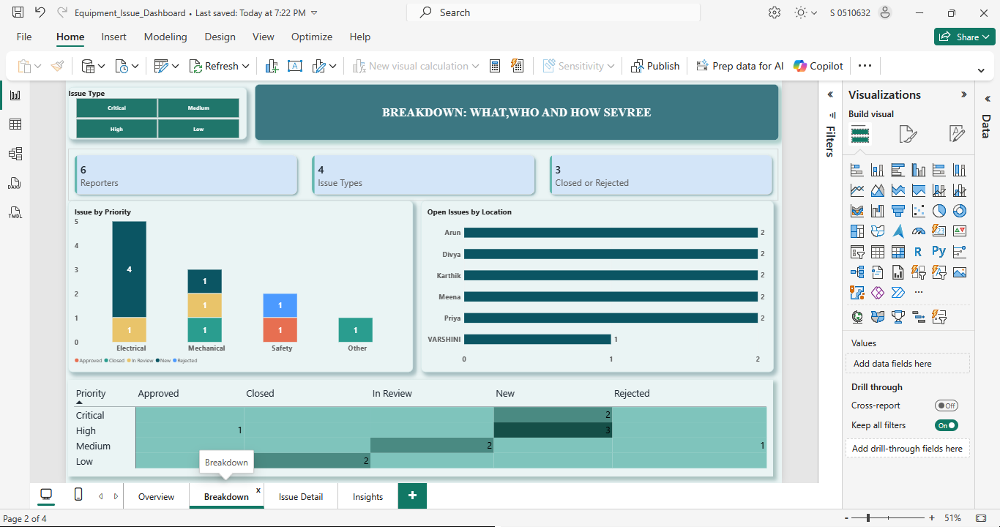
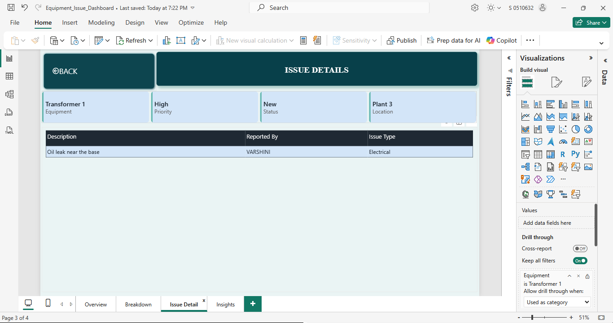
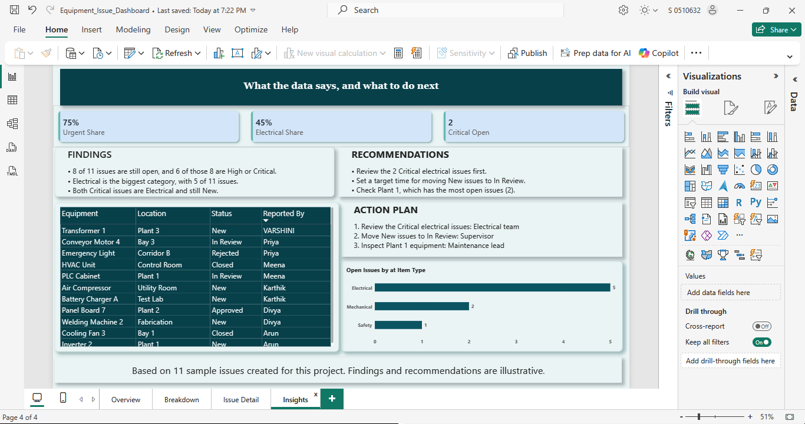
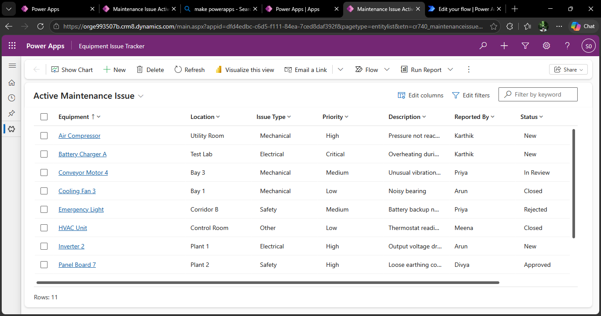
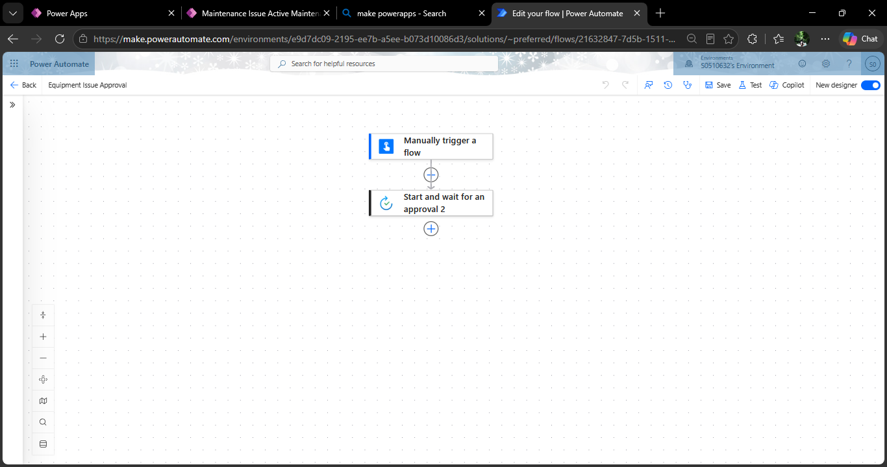
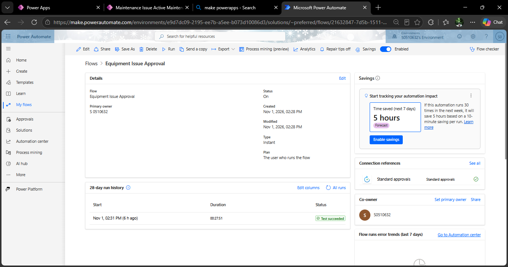
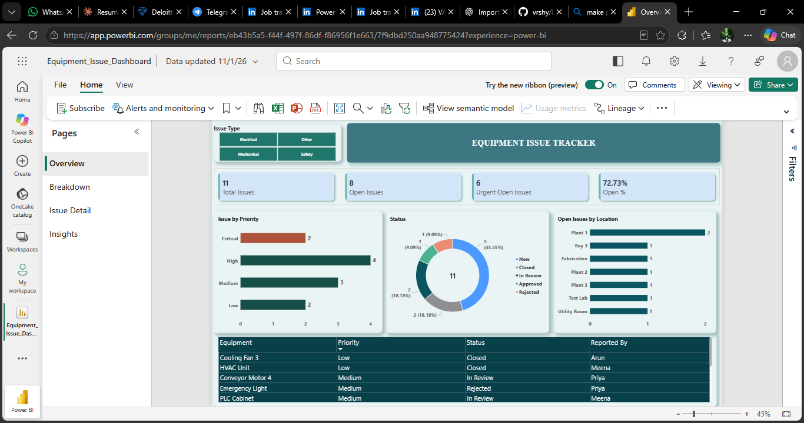

# Equipment Issue Tracker (Power Apps, Power Automate, Power BI)

A small end-to-end Power Platform project: equipment issues are stored in Dataverse, logged and reviewed through a Power Apps app, routed for approval with a Power Automate flow, and analysed in a four-page Power BI dashboard.

**Data:** 11 sample issues created for this project (not real company data)
**Tools:** Power Apps (model-driven), Microsoft Dataverse, Power Automate, Power BI Desktop, Power Query (M), DAX

---

## Screenshots

### Power BI dashboard

**Overview**


**Breakdown**


**Issue Detail (drill-through page)**


**Insights**


### Power Apps and Power Automate

**App: list of issues**


**Flow design**


**Flow run history (test succeeded)**


### Power BI Service

**Report published to Power BI Service**


---

## What each part does

| Part | What I built |
|---|---|
| **Dataverse table** | `Maintenance Issue` with Equipment, Location, Issue Type, Priority, Status, Description, Reported By and Date Reported. Created by importing a CSV of sample issues |
| **Power Apps** | A model-driven app, `Equipment Issue Tracker`, with a list view and a form for logging new issues. I added one issue (Transformer 1) through the form to test it |
| **Power Automate** | An instant flow, `Equipment Issue Approval`. A manual trigger takes Equipment, Priority and Location, then sends an Approve/Reject request (first to respond). The test run succeeded |
| **Power BI** | A four-page report connected to Dataverse |

---

## Power BI report

| Page | Contents |
|---|---|
| **Overview** | Four KPI cards (Total Issues, Open Issues, Urgent Open Issues, Open %), issues by priority, status donut, open issues by location, issue list |
| **Breakdown** | Issue Type by Status, issues by reporter, Priority x Status heatmap |
| **Issue Detail** | Drill-through page: right-click an equipment name on the Overview page to see its full details |
| **Insights** | Findings, recommendations, an action plan and a table of urgent open issues |

### Data preparation (Power Query)

- Connected to the Dataverse table and kept only the useful columns.
- Used the label columns for Issue Type, Priority and Status so they show words instead of numeric codes.
- Renamed columns and set Date Reported as a date.
- Added a `Priority Order` column (Critical = 1, High = 2, Medium = 3, Low = 4) and used it to sort Priority by severity.

### DAX measures (10)

| Measure | Purpose |
|---|---|
| `Total Issues` | Number of issues |
| `Open Issues` | Issues that are not Closed or Rejected |
| `Closed or Rejected` | Total minus open |
| `Urgent Open Issues` | Open issues with High or Critical priority |
| `Open %` | Open issues as a share of all issues |
| `Reporters` | Distinct people who reported issues |
| `Issue Types` | Distinct issue types |
| `Urgent Share` | Urgent open issues as a share of open issues |
| `Electrical Share` | Electrical issues as a share of all issues |
| `Critical Open` | Open issues with Critical priority |

**Definition used:** an issue is **open** unless its status is Closed or Rejected. So New, In Review and Approved all count as open.

### Theme

The report uses a custom colour theme, `teal_corporate_theme.json` (Power BI: View > Themes > Browse for themes).

---

## Findings (from the sample data)

- 8 of 11 issues (73%) are still open, and 6 of those 8 are High or Critical.
- Electrical is the largest category, with 5 of 11 issues (45%).
- Both Critical issues are Electrical and still New.
- Plant 1 has the most open issues (2).

These findings and the recommendations on the Insights page are **illustrative**. They show how the dashboard would be used, and they are not results from a real company.

---

## Repository contents

```
equipment-issue-tracker-powerplatform/
├── Equipment_Issue_Dashboard.pbix
├── teal_corporate_theme.json
├── data/
│   └── equipment_issues.csv
├── screenshots/
└── README.md
```

---

## How to use the files

1. Open `Equipment_Issue_Dashboard.pbix` in Power BI Desktop (Windows) to see the report as built.
2. The report reads from my Dataverse environment, so it will not refresh on another account. To rebuild it, import `data/equipment_issues.csv` into your own Dataverse table (Power Apps > Tables > Import), then point the Power BI connection to your environment.

---

## Limitations

- **Sample data only.** The 11 issues were written for this project.
- **The flow is triggered manually.** It does not read the Dataverse table. Triggering automatically when a row is added needs the Dataverse connector, which requires a Power Automate Premium licence that my account does not have.
- **The approval request goes to my own account.** It shows the approval step working, and it is not a full approval process with a supervisor.
- **Published to Power BI Service, but without scheduled refresh or row-level security.** Both are still to do.
- **Date Reported is not used in any chart.** In the imported rows the dates shifted by one day during import, so I left date-based charts out.

---

## Next steps

- Move the data to a source that lets the flow trigger on a new row.
- Send the approval to a separate approver and email the decision to the reporter.
- Set up scheduled refresh in Power BI Service and add row-level security.
- Fix the date shift on import and add a trend chart.

---

## Author

**Varshini G**
[GitHub](https://github.com/vrshy) | [LinkedIn](https://linkedin.com/in/varshiganesan)
